# WebRTC 시그널링 흐름

`SignalingService.Signaling` (gRPC 양방향 스트림) 위에서 일어나는 모든 일을 그림으로 정리한다.
코드 기준: `proto/public/signaling/v1/signaling.proto`, `internal/{handler,usecase/service,signaling,manager,domain}`

---

## 1. 토폴로지 — SFU

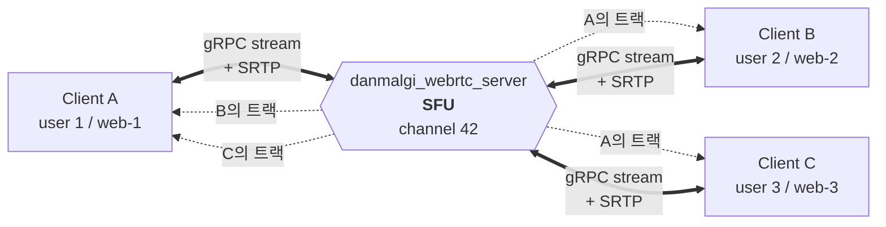

> 클라이언트끼리 P2P를 맺지 않는다. 각자 **서버와 1:1 PeerConnection** 하나만 맺고, 서버가 되쏜다.

---

## 2. 누가 offer를 만드는가

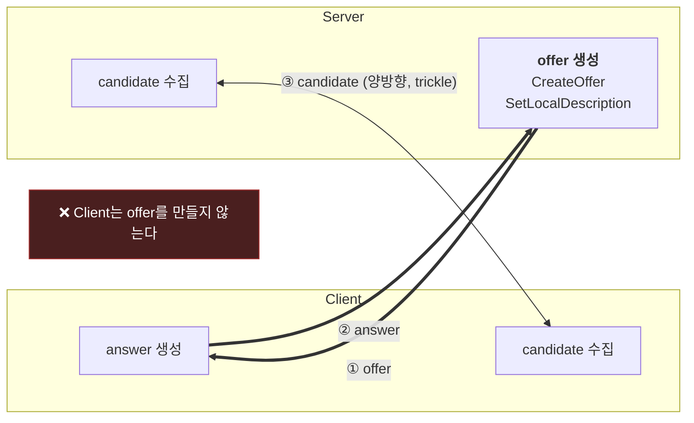

| | `SignalingRequest` (C→S) | `SignalingResponse` (S→C) |
|---|---|---|
| oneof 필드 | `answer`, `candidate` | `offer`, `answer`*, `candidate` |

* proto에 정의만 있고 서버는 보내지 않음

---

## 3. 컴포넌트 맵

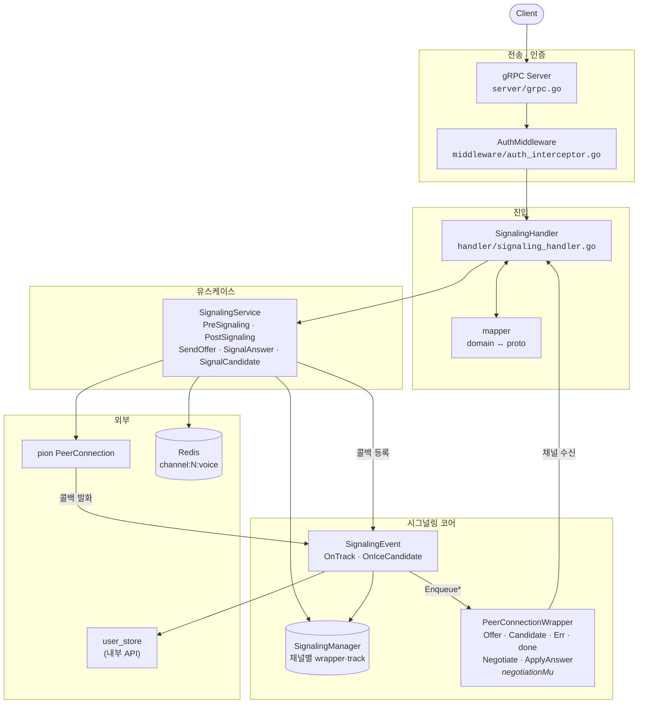

---

## 4. 연결 수립

```mermaid
sequenceDiagram
    autonumber
    participant C as Client
    participant I as AuthMiddleware
    participant H as Handler
    participant S as SignalingService
    participant P as pion PC
    participant R as Redis

    rect rgb(30,45,65)
    Note over C,I: 인증
    C->>I: Signaling() 개시<br/>md: authorization, channel_id
    I->>I: token.Validate → userId, deviceId
    I->>I: GetUserByID(userId)
    I-->>H: ctx { UID, DID, USER }
    end

    rect rgb(30,55,45)
    Note over H,R: PreSignaling
    H->>H: channel_id 파싱
    H->>S: PreSignaling(userId, channelId, deviceId)
    S->>P: NewPeerConnection<br/>STUN · NAT1To1 · UDP 49000-49010
    S->>P: AddTransceiver(audio, <b>recvonly</b>)
    S->>P: OnTrack · OnICECandidate · OnConnectionStateChange
    S->>S: Manager.Save(channelId, wrapper)
    S->>R: HSET channel:N:voice [deviceId]=userId<br/>EXPIRE 2m
    S-->>H: wrapper
    end

    rect rgb(55,45,30)
    Note over C,P: 협상
    H->>H: recv · send goroutine 기동
    H->>S: SendOffer(wrapper)
    S->>P: Negotiate: CreateOffer · SetLocalDescription
    S->>S: GetTracks → 명단 스냅샷 (자기 제외)
    H-->>C: Response{ offer + joined_user_tracks }
    C->>C: setRemoteDescription → createAnswer
    C->>H: Request{ answer }
    H->>S: SignalAnswer → ApplyAnswer<br/>(SetRemoteDescription + pending 확인)
    end

    par trickle ICE
        P-->>H: OnICECandidate
        H-->>C: Response{ candidate }
    and
        C->>H: Request{ candidate }
        H->>S: SignalCandidate → AddICECandidate
    end

    Note over C,P: ICE ✓ → DTLS ✓ → SRTP 흐름 시작
```

**첫 offer의 모양**

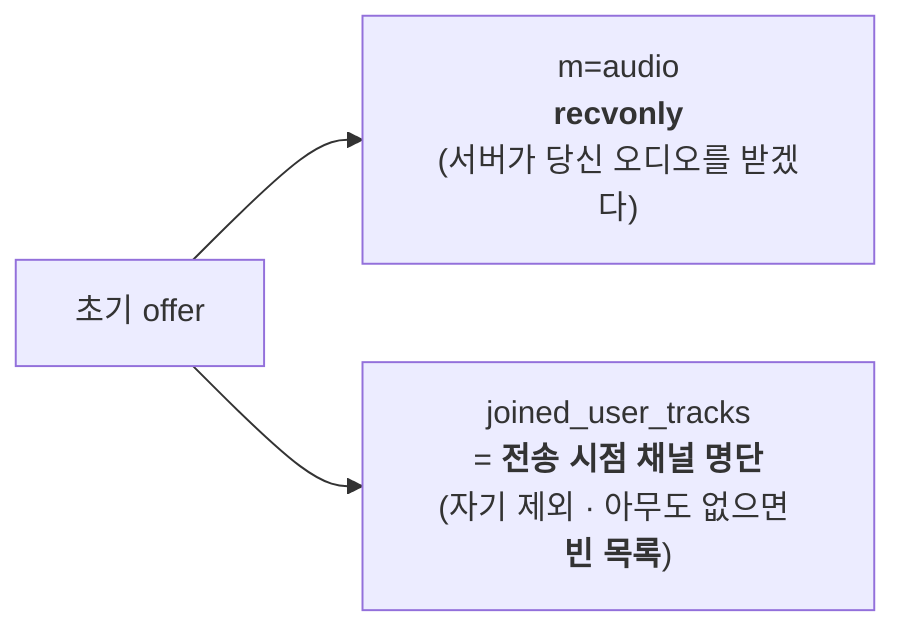

> 첫 offer라고 해서 명단이 비는 게 아니다. 이미 발행 중인 참가자가 있으면 그 목록이 그대로 실린다.
> 반대로 아무도 없으면 **필드 부재가 아니라 빈 목록**으로 온다 — 그래야 "마지막 한 명이 나갔다"를 표현할 수 있다.

---

## 5. 핸들러 내부 — goroutine 3개

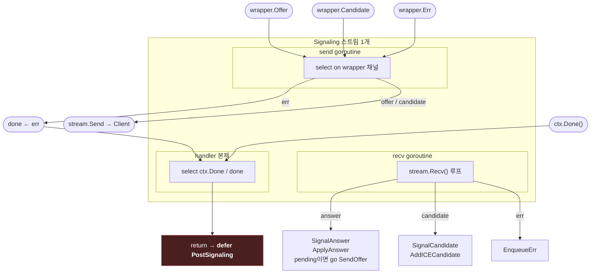

---

## 6. 트랙 발행 → 팬아웃 (핵심)

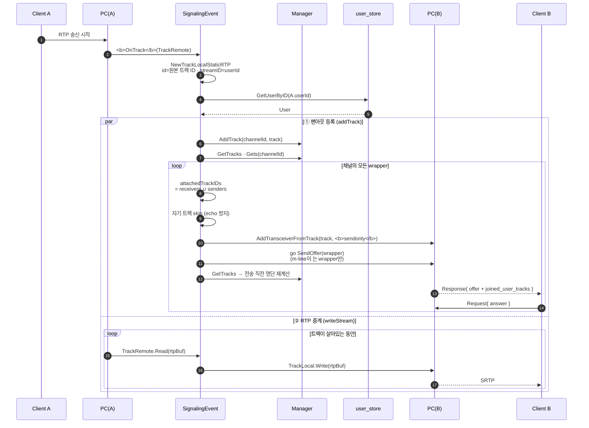

### 6.1 자기 목소리가 되돌아오지 않는 이유

필터가 **두 겹**이다. 집합 연산(`filterUnattachedTracks`)이 중복 부착을 막고, 그 안쪽의 명시적 소유자 검사가 echo를 막는다.

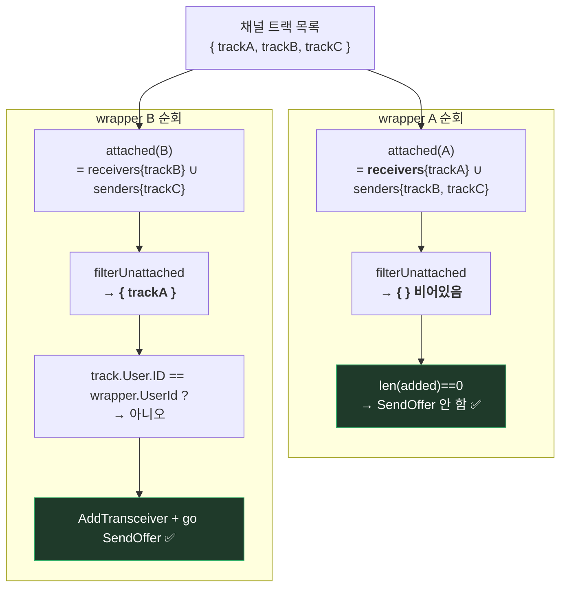

> A가 올린 트랙은 A의 PeerConnection에 **receiver**로 이미 잡혀 있다 → 집합 연산에서 제외.
> 같은 함수가 **중복 부착 방지**도 겸한다 (늦게 들어온 참가자에게 기존 트랙을 몰아 붙일 때).

**⚠️ echo 필터는 wrapper가 아니라 트랙 단위로 건다.** receiver에 트랙이 붙기 **전** 타이밍에는 자기 트랙이 "새 트랙"으로 보여 집합 연산만으로는 되돌아간다. 그래서 `newTracks` 루프 안에 `newTrack.User.ID == wrapper.UserId` 검사가 따로 있다(`snapshotForWrapper`의 자기 제외와 **같은 기준**).

바깥 wrapper 순회 상단에서 걸러선 안 된다 — `AddTransceiverFromTrack`이 실행되는 곳이 이 순회 **안**이라, wrapper를 통째로 skip하면 신규 입장자가 기존 트랙을 붙을 유일한 기회가 사라져 **아무 소리도 안 들리는** 회귀가 된다.

### 6.2 offer에 실리는 트랙 정보

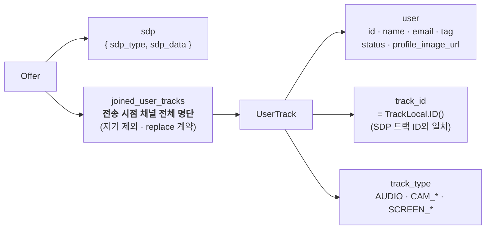

> ⚠️ `track_type`은 pion `t.Kind()`(audio=1, video=2)를 그대로 넣어 proto enum(AUDIO=0, CAM_AUDIO=1, CAM_VIDEO=2)과 한 칸씩 어긋난다. 캠/화면공유 구분이 필요해지면 이 매핑부터 정리해야 한다.

### 6.3 스냅샷 계약 — 델타가 아니다

`joined_user_tracks`는 **매 offer마다 명단 전체**다. 클라이언트는 받을 때마다 **통째로 교체(replace)** 해야 하며, 누적(merge)하면 퇴장자가 영영 남는다.

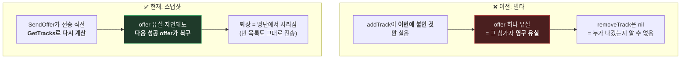

핵심은 **누가 명단을 만드는가**다. 호출자가 인자로 넘기지 않고 `SendOffer`가 전송 직전 매니저에서 직접 뜬다 — 그래서 실패한 전송이 손실로 남지 않는다.

> 이것이 이슈 #5("3명 접속 시 기존 참가자에게 2명만 보임")의 직접 원인이었다.

> ⚠️ **명단에 있다고 해당 m-line이 있는 건 아니다.** 스냅샷은 매니저의 전체 트랙에서 뜨는데, 마이크를 켜지 않은 참가자는 `addTrack`을 유발하지 않아 아직 SDP에 m-line이 없다. `track_id` ↔ m-line 매핑을 전제로 렌더링하면 "이름은 뜨는데 소리가 없는" 상태가 보일 수 있다 (후속: 입장 트리거 팬아웃).

---

## 7. 재협상 트리거

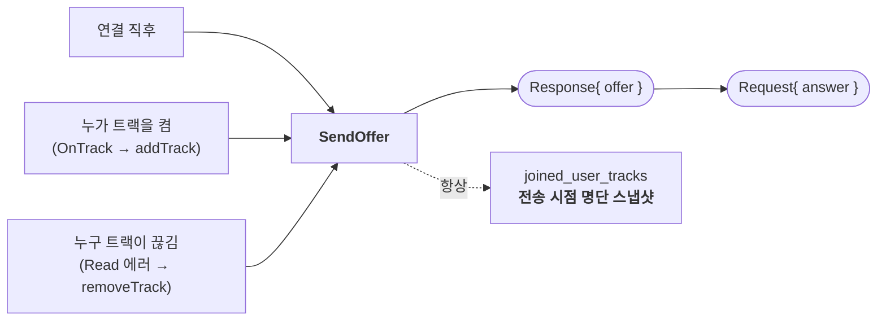

> 트리거가 무엇이든 실리는 건 **언제나 전체 명단**이다. "추가일 때만 있음 / 제거일 때는 없음" 같은 분기는 없다.

### 7.1 glare — 이전 offer의 answer를 기다리는 중이라면

여러 참가자가 동시에 들어오면 `addTrack`이 wrapper마다 `go SendOffer`를 띄우는데, 그 PeerConnection이 아직 `have-local-offer`면 pion이 두 번째 offer를 거부한다. 예전에는 이 에러를 조용히 삼켜 **그 offer에 실린 명단이 통째로 사라졌다.**

```mermaid
sequenceDiagram
    autonumber
    participant F as 팬아웃 goroutine
    participant W as wrapper<br/>(negotiationMu)
    participant P as pion PC
    participant C as Client

    F->>W: Negotiate(prepare)
    W->>P: SignalingState() = <b>stable</b> ✅
    W->>P: CreateOffer · SetLocalDescription
    W-->>F: sent = true
    F->>C: EnqueueOffer (<b>락 밖</b>)
    Note over P: 상태 = have-local-offer

    rect rgb(55,45,30)
    Note over F,P: 이때 새 참가자 입장 → 두 번째 SendOffer
    F->>W: Negotiate(prepare)
    W->>P: SignalingState() = <b>have-local-offer</b> ❌
    W->>W: pendingNegotiation = true
    W-->>F: sent = false (에러 아님, 버려도 안전)
    end

    C->>W: answer 도착 → ApplyAnswer
    W->>P: SetRemoteDescription → stable
    W->>W: pending 소비 (true → false)
    W-->>F: pending = true
    Note over F: SignalAnswer가 go SendOffer로 <b>재개</b><br/>→ 이번엔 완전한 명단을 싣는다
```

| 규칙 | 이유 |
|---|---|
| `Negotiate`와 `ApplyAnswer`는 **같은** `negotiationMu` | 한쪽이 락 밖이면 lost-wakeup — pending을 세운 직후 소비자가 이미 지나가 **깨울 answer가 영영 안 온다** (에러도 로그도 없이 그 참가자만 정지) |
| `Enqueue*`는 락 **밖**에서 | Offer 채널이 언버퍼드라 락을 쥔 채 send하면 클라이언트 읽기 속도에 재협상 전체가 묶인다 |
| 지연된 offer는 그냥 버린다 | 스냅샷 계약 덕에 손실이 없다 → pending이 카운터가 아니라 `bool`이어도 충분 |
| 재개는 `go`로 | 호출자가 handler의 recv 루프라 인라인 실행하면 인바운드 시그널링이 멈춘다 |

---

## 8. 종료

```mermaid
sequenceDiagram
    autonumber
    participant A as Client A
    participant EV as SignalingEvent
    participant PB as PC(B)
    participant B as Client B
    participant H as Handler(A)
    participant S as Service
    participant R as Redis

    rect rgb(55,45,30)
    Note over A,B: ① 트랙만 끊긴 경우
    A--xEV: RTP 중단 → TrackRemote.Read 에러
    EV->>EV: writeStream 종료 → <b>defer removeTrack</b>
    EV->>EV: ① Manager.RemoveTrack (먼저!)
    loop 소유자(track.User.ID == wrapper.UserId) 제외
        EV->>PB: ② RemoveTrack(sender)
        EV->>PB: ③ go SendOffer(wrapper)
        PB-->>B: Response{ offer + 퇴장자 빠진 명단 }
        B->>PB: Request{ answer }
    end
    end

    rect rgb(60,30,30)
    Note over A,R: ② 스트림이 끊긴 경우
    A--xH: EOF / ctx.Done / Err
    H->>S: <b>defer PostSignaling</b>
    S->>R: HDEL channel:N:voice [deviceId]
    S->>S: Manager.Delete(channelId, wrapper)
    S->>S: PeerConnection.Close()
    S->>S: wrapper.Close()  → close(done)
    Note over S: 이후 모든 Enqueue*는 false 반환 (drop, panic 없음)
    end
```

> ⚠️ `removeTrack`의 **순서가 계약의 일부**다. 매니저에서 먼저 지워야(①) 이후 `SendOffer`가 뜨는 스냅샷에서 퇴장자가 빠진다. 이 제거를 `defer`로 미루면 퇴장자가 명단에 그대로 남는다.

**세 갈래가 한 곳으로 수렴**

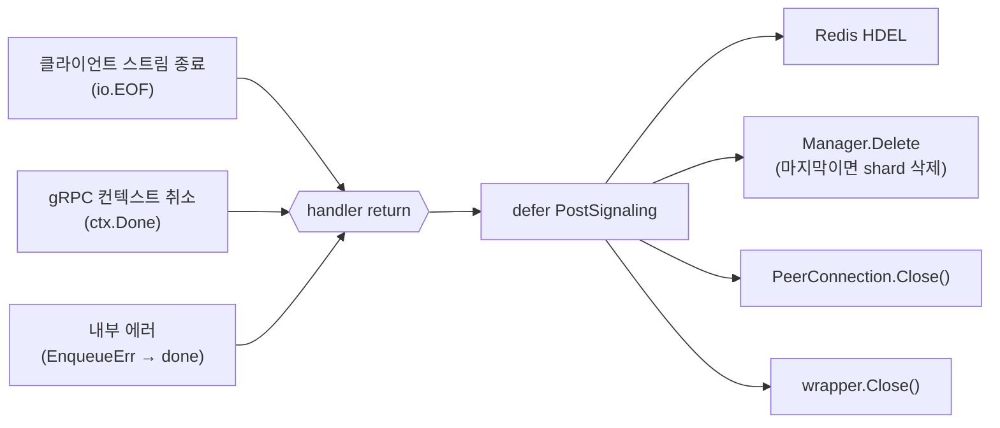

---

## 9. 서버가 들고 있는 상태

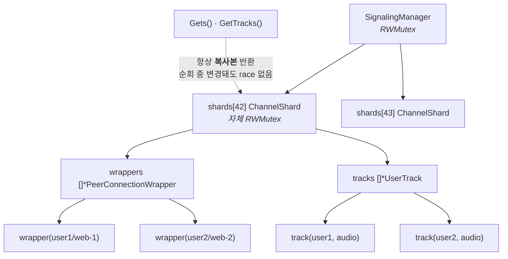

> 상태가 프로세스 메모리에 있으므로 **단일 인스턴스 전제**다. 수평 확장하려면 채널 단위 라우팅(같은 채널 → 같은 인스턴스)이나 SFU 간 릴레이가 필요하다.

**Redis presence**

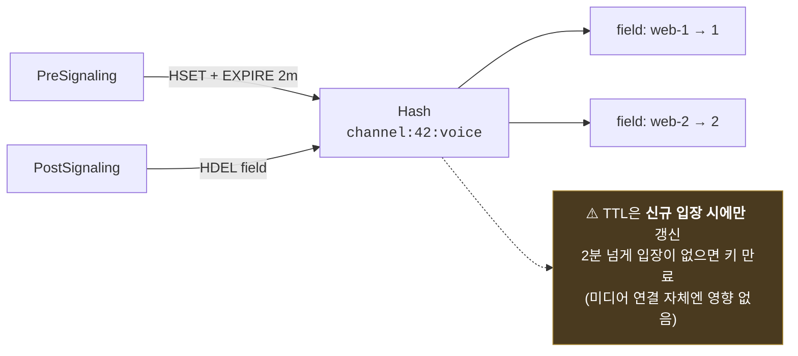

---

## 10. 식별 축 3개

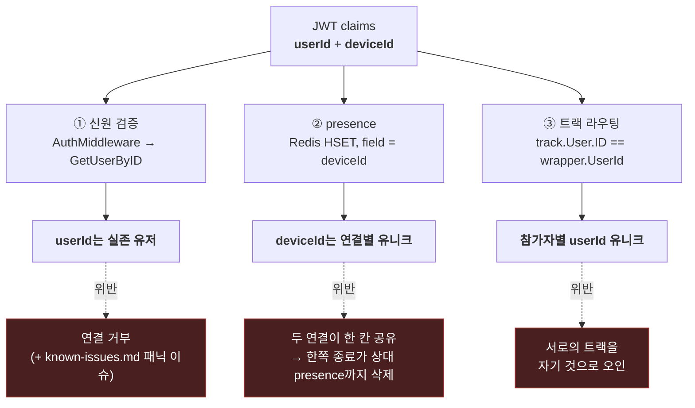

> 새 클라이언트/어댑터를 만들 때 세 축을 **한꺼번에** 점검한다.

---

## 11. 채널 수명주기 (동시성 규칙)

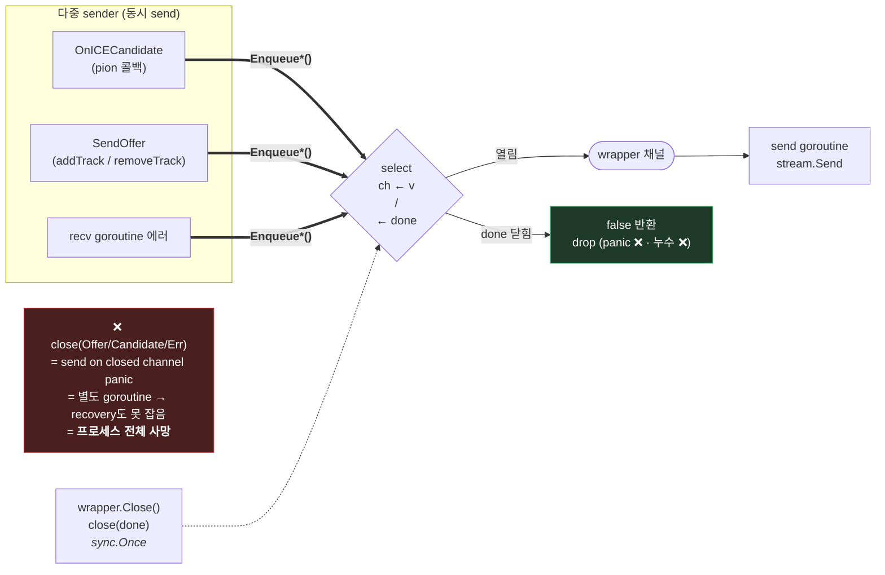

| 규칙 | |
|---|---|
| ① 소유자가 데이터 채널을 close하지 않는다 | 종료 신호는 오직 `wrapper.Close()` (= `close(done)`) |
| ② 직접 `ch <-` 금지 | 항상 `EnqueueOffer` / `EnqueueCandidate` / `EnqueueErr` |

> 새 send 지점이나 새 채널을 추가할 때도 동일 규칙을 적용한다.

---

## 12. 클라이언트 상태 머신

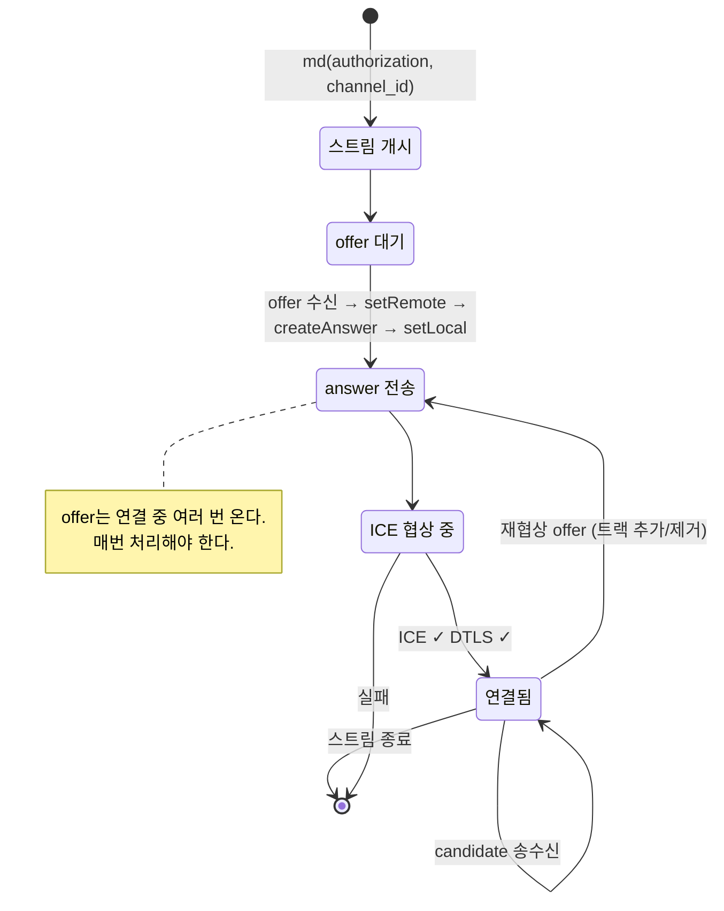

**체크리스트**

- [ ] `authorization: Bearer <JWT>` + `channel_id` 메타데이터로 스트림 개시
- [ ] `offer` 수신 → `setRemoteDescription` → `createAnswer` → `setLocalDescription` → `answer` 전송 **(여러 번 발생)**
- [ ] 로컬 candidate 생기는 즉시 전송 / 서버 candidate 받는 즉시 `addIceCandidate`
- [ ] `joined_user_tracks`를 받을 때마다 참가자 목록을 **통째로 교체** — 누적(merge)하면 퇴장자가 남는다
- [ ] 빈 목록은 "아무도 없음"이라는 **유효한 상태**다 — 무시하면 마지막 참가자가 사라지지 않는다
- [ ] offer를 직접 만들지 않는다 — 마이크를 나중에 켜도 서버가 재협상을 주도

**로컬 검증**

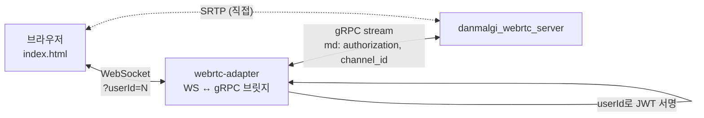

자세한 사용법: [`tools/webrtc-adapter/README.md`](../tools/webrtc-adapter/README.md)

---

## 관련 문서

- [`README.md`](../README.md) — 환경 변수, 실행 방법
- [`docs/known-issues.md`](known-issues.md) — 존재하지 않는 userId로 인한 패닉 등 후속 과제
- [`CLAUDE.md`](../CLAUDE.md) — 채널 수명주기·식별 축 규칙 원본
